<p align="center">
  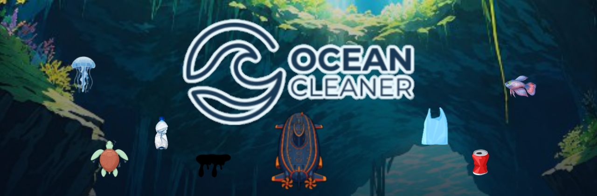
</p>

<h1 align="center">Ocean Cleaner</h1>

<p align="center">An arcade game about cleaning the ocean, made with Python and Pygame Zero</p>

<p align="center">
  
  
  
  
</p>

<hr>

<h3 align="center">About</h3>

<table align="center">
  <tr>
    <td>
      <table>
        <tr><td>🎓 <b>Course</b></td><td>Practices in Software Development</td></tr>
        <tr><td>🐍 <b>Engine</b></td><td>Python + Pygame Zero</td></tr>
        <tr><td>🌊 <b>Levels</b></td><td>100, a boss on every 10th</td></tr>
        <tr><td>⭐ <b>Goal</b></td><td>Clean the trash before it sinks</td></tr>
        <tr><td>👤 <b>Made by</b></td><td>Md. Arafat Hosen</td></tr>
      </table>
    </td>
    <td align="center">
      
    </td>
  </tr>
</table>

<p align="justify">
You drive a cleaning submarine and catch falling trash with nets. Every piece that sinks hurts the
ocean, so you cannot just hide. Fish and turtles must not be hit, plastic bags trap turtles that you
have to free, and oil spills split and slow you down. Before every level the game shows a real fact
about ocean pollution.
</p>

<hr>

<h3 align="center">Screenshots</h3>

<table align="center">
  <tr>
    <td align="center">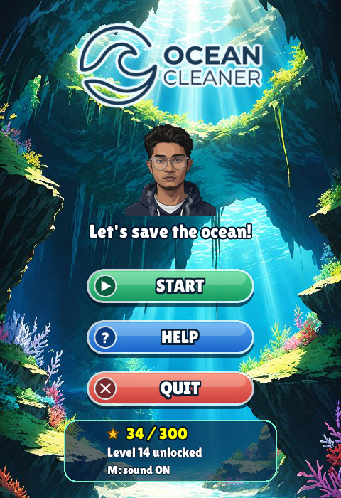<br><sub>Menu</sub></td>
    <td align="center">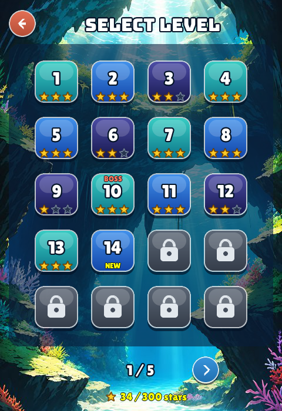<br><sub>100 levels</sub></td>
    <td align="center">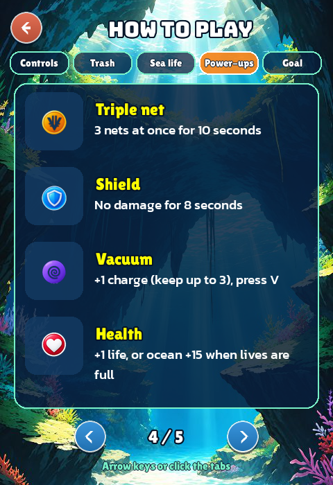<br><sub>How to play</sub></td>
  </tr>
  <tr>
    <td align="center">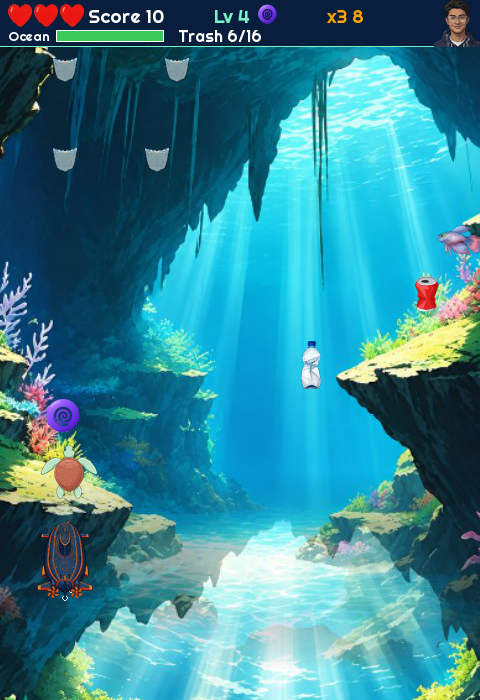<br><sub>The Coast</sub></td>
    <td align="center">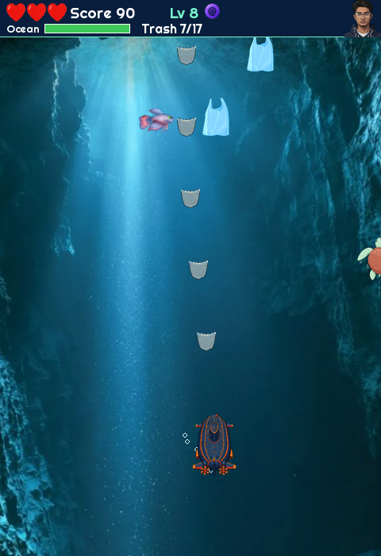<br><sub>Open Sea</sub></td>
    <td align="center">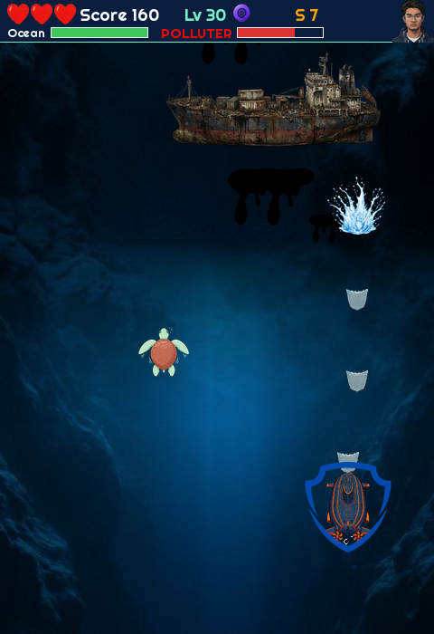<br><sub>The POLLUTER</sub></td>
  </tr>
</table>

<hr>

<h3 align="center">The Cast</h3>

<table align="center">
  <tr>
    <td align="center"><br><sub>Submarine</sub></td>
    <td align="center">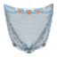<br><sub>Net</sub></td>
    <td align="center">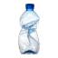<br><sub>Bottle +10</sub></td>
    <td align="center">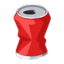<br><sub>Can +10</sub></td>
    <td align="center">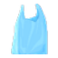<br><sub>Bag +15</sub></td>
    <td align="center">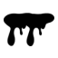<br><sub>Oil +30</sub></td>
    <td align="center">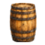<br><sub>Barrel</sub></td>
    <td align="center">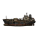<br><sub>Boss</sub></td>
  </tr>
  <tr>
    <td align="center">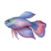<br><sub>Fish</sub></td>
    <td align="center">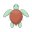<br><sub>Turtle</sub></td>
    <td align="center">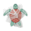<br><sub>Trapped +50</sub></td>
    <td align="center">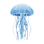<br><sub>Jellyfish</sub></td>
    <td align="center"><br><sub>Triple net</sub></td>
    <td align="center"><br><sub>Shield</sub></td>
    <td align="center"><br><sub>Vacuum</sub></td>
    <td align="center"><br><sub>Health</sub></td>
  </tr>
</table>

<hr>

<h3 align="center">Controls</h3>

<table align="center">
  <tr><td align="center"><kbd>←</kbd> <kbd>→</kbd> <kbd>↑</kbd> <kbd>↓</kbd> or <kbd>W</kbd> <kbd>A</kbd> <kbd>S</kbd> <kbd>D</kbd></td><td>Move</td></tr>
  <tr><td align="center"><kbd>Space</kbd></td><td>Throw nets</td></tr>
  <tr><td align="center"><kbd>V</kbd></td><td>Vacuum</td></tr>
  <tr><td align="center"><kbd>P</kbd> <kbd>R</kbd> <kbd>M</kbd></td><td>Pause, restart, sound</td></tr>
  <tr><td align="center"><kbd>Esc</kbd></td><td>Back</td></tr>
</table>

<hr>

<h3 align="center">How It Works</h3>

<p align="justify">
Pygame Zero calls <code>update()</code> 60 times a second to move everything and <code>draw()</code> to paint the
screen. All objects are Actors kept in lists, the background scrolls with two Actors, and collisions use
slightly smaller boxes so they feel fair. The 100 levels come from one function, <code>level_config(n)</code>,
where every number grows a little each level and stops at a limit. A cleaned piece of trash drops a
power-up with <code>random.random() &lt; 0.08</code>, and <code>random.choice</code> picks which one. Progress,
stars and the best scores are saved in <code>progress.json</code>.
</p>

<h3 align="center">Built With</h3>

<p align="center">
  
</p>

<hr>

<h3 align="center">Run It</h3>

```bash
pip install pgzero
python main.py
```

<p align="justify">
The <code>tools</code> folder holds the helpers used to make the game: <code>import_art.py</code> resizes my own
pictures for the game, <code>make_seamless.py</code> makes a background loop without a visible line, and
<code>make_ui.py</code> draws the buttons, level tiles and stars.
</p>

<hr>

<h3 align="center">Ocean Facts</h3>

<p align="justify">
11 million tonnes of plastic enter the ocean every year. A plastic bottle may take up to 450 years to break
down. 817 kinds of sea animals are harmed by litter, and plastic has been found 10,898 m deep in the
Mariana Trench. Sources: Pew 2020, NOAA, UN CBD 2016, WWF and Jamieson et al. 2019, listed in
<a href="docs/game_data.txt">docs/game_data.txt</a>.
</p>

<p align="justify">
<sub>Fonts: Bungee, Lilita One, Righteous and Kanit, all under the SIL Open Font License.</sub>
</p>

<hr>

<p align="center">Made with 💙 by <b>Md. Arafat Hosen</b></p>
